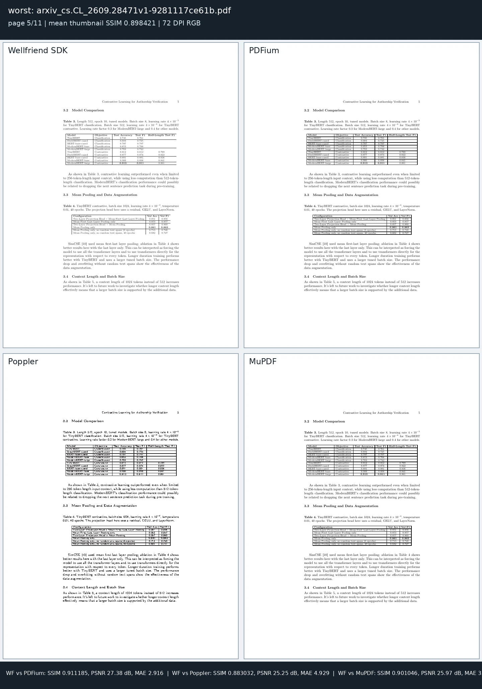
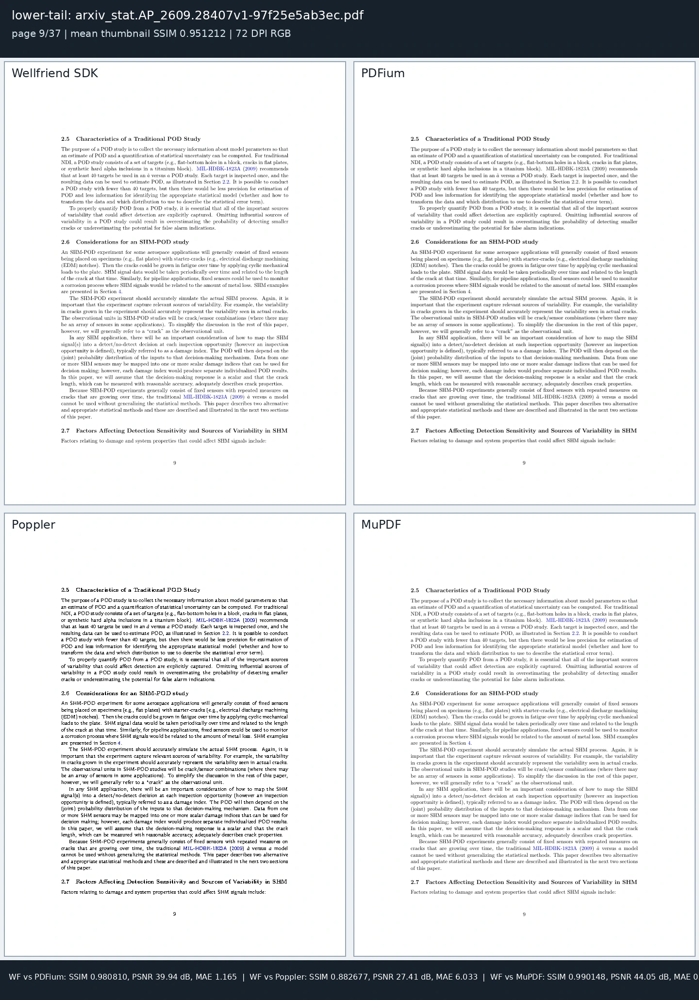
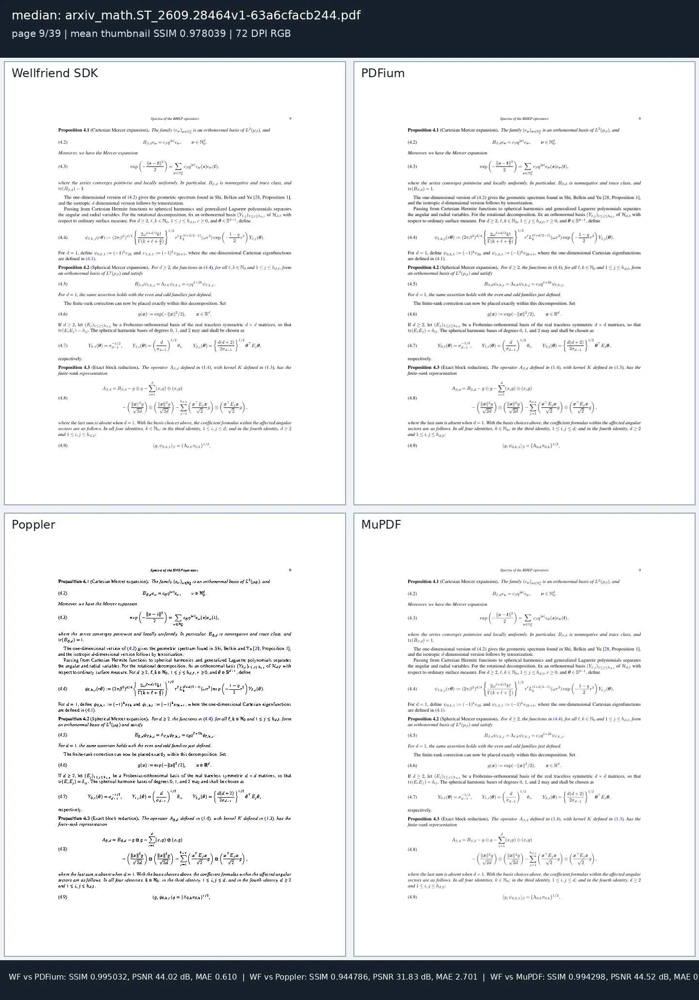
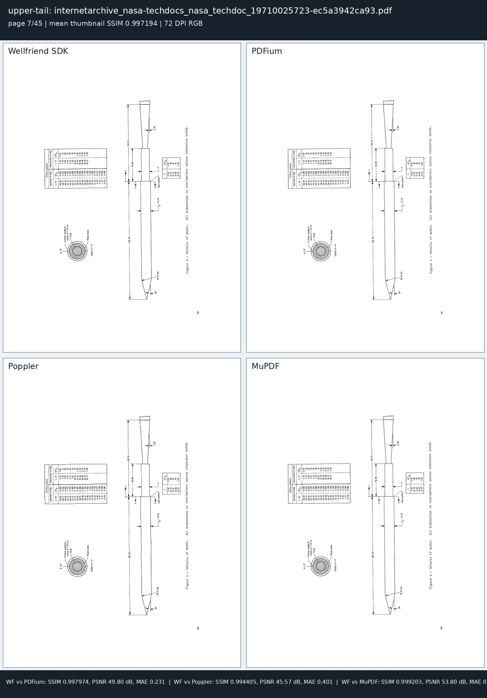

# Wellfriend PDF SDK

Most PDF stacks are a pile of libraries taped together — one thing parses, another
renders, a third edits, a fourth converts, and a fifth signs. They disagree about
what the document even is, and you spend your life reconciling them.

Wellfriend is one engine. It opens the real structure of a PDF, turns it into
pixels and data you can trust, edits the actual source content, and writes the
result back out — all through the same Rust core. One document model carries the
work from the bytes a user uploads to the file they download.

You can call that core straight from Rust, or reach it through the CLI, an HTTP
API, C, Python, WebAssembly, .NET, or Java. Same engine underneath, whichever
door you come in through.

---

## Benchmark

Wellfriend is measured against **PDFium** (the renderer in Chrome) and **MuPDF** on
the same hardware, the same files, and the same operations: 200 real-world PDFs —
scanned newspapers, reports, forms, multi-column journals, and image-heavy
documents — rendered at page 1, 120 DPI. CPU and memory figures use a 40-document
subset of the heaviest scans (each ≤ 50 MB) and are reported as User + System CPU
time on a single core.

### Rendering fidelity

Each engine renders the same page; outputs are compared pixel-for-pixel with SSIM
(1.0 = identical). PDFium and MuPDF agree with each other at 0.969 — the practical
ceiling for independent renderers.

| Pair | SSIM | Render success |
|---|---|---|
| Wellfriend vs MuPDF | **0.951** | 199 / 200 |
| Wellfriend vs PDFium | **0.936** | — |
| PDFium vs MuPDF | 0.969 | 200 / 200 |






### Rendering throughput

CPU time and peak memory to render one page, single core, across the heaviest
scans.

| Engine | CPU per page | Peak RAM | CPU vs PDFium |
|---|---|---|---|
| PDFium | 254 ms | 425 MB | 1.00× |
| **Wellfriend** | **404 ms** | **712 MB** | 1.59× |
| MuPDF | 1,785 ms | 731 MB | 7.02× |

Wellfriend renders at 1.6× PDFium's CPU cost and **4.4× faster than MuPDF**, with
memory between the two.

### Text extraction

Extracted text compared to MuPDF (median similarity over the 70 documents with a
text layer); extraction runs at ~38 ms/page.

| Pair | SSIM |
|---|---|
| Wellfriend vs MuPDF | **0.886** |
| PDFium vs MuPDF | 0.962 |

### Parsing, tables, and conversions

These are first-class Wellfriend operations with no equivalent in PDFium or MuPDF.

| Operation | Documents | Success | Mean time |
|---|---|---|---|
| Structural parse | 200 | **99.5%** | 3.3 s |
| Table extraction | 200 | 97.5% | 3.5 s |
| PDF → Markdown | 200 | **99.5%** | 3.2 s |
| PDF → HTML | 200 | **99.5%** | 3.2 s |
| PDF → JSON | 200 | **99.5%** | 3.3 s |
| PDF → XLSX | 200 | **99.5%** | 3.3 s |
| PDF → DOCX | 40 heavy | 85.0% | 43.3 s |
| PDF → EPUB | 40 heavy | 70.0% | 49.0 s |
| PDF → PPTX | 40 heavy | 67.5% | 50.4 s |

### Editing

Source-linked text editing — replacing content and writing a valid PDF back — with
no equivalent in PDFium or MuPDF.

| Metric | Result |
|---|---|
| Reflow succeeded | 87.3% |
| Output valid (qpdf `--check`) | 95.7% |
| Edit applied | 98.6% |
| Unedited-page fidelity (SSIM) | **0.9991** |

The last row is the guarantee: changing a word leaves the rest of the page
pixel-identical.

### Deeper evidence

A separate, larger campaign — **150 documents, 9,214 pages, 2.036 GiB** — covers
the full span of document operations (merge, split, sign, linearize, PDF/A
conversion, and more) against PDFium, Poppler, MuPDF, and qpdf, with hashed
per-file evidence. The full report, `summary.json`, and `SHA256SUMS` are in
[`docs/reports/final-benchmark-vps-20261008/`](docs/reports/final-benchmark-vps-20261008/README.md).

---

## What you can build with it

| You want to… | Wellfriend handles… |
|---|---|
| **Understand a document** | Page trees, content streams, text, tables, forms, annotations, attachments, metadata, fonts, images, signatures, and logical structure |
| **Turn pages into images** | PNG, JPEG, WebP, raw pixels, SVG, PostScript, and EPS — with transparency, masks, color management, clipping, patterns, shadings, and Type 3 fonts |
| **Edit the actual content** | Source-linked text and object edits, paragraph and linked-story reflow, image and vector changes, scanned-word reconstruction, forms, annotations, watermarking, and redaction |
| **Rebuild and repackage** | Merge, split, extract, rotate, crop, resize, organize, flatten, linearize, optimize, sanitize, encrypt, decrypt, and sign |
| **Hand off to other formats** | Text, Markdown, JSON, HTML, DOCX, PPTX, XLSX, images, and PDF/A workflows |

---

## Getting started

```powershell
git clone https://github.com/demisuga01-lab/wellfriendpdf.git
cd wellfriendpdf
cargo build --workspace --jobs 2
```

The engine ships with `parse`, `render`, and `structural` turned on by default.
Flip on the `full` feature when you need extraction, creation, editing, signing,
standards, and the OCR-facing APIs.

What each surface needs:

| Surface | Requirement |
|---|---|
| Rust workspace | Rust 1.95+ and Cargo |
| Python | Python 3.9+ and `maturin` |
| WebAssembly | `wasm-pack` and a `wasm32` Rust target |
| .NET | .NET 8 SDK |
| Java | JDK 25 with preview FFM enabled |
| Native (C ABI) | A locally built `wellfriendpdf_capi` shared library |
| OCR (optional) | Tesseract dev + runtime libraries |
| Native color (optional) | Build with `native-cmm-lcms2` |

And how the workspace is laid out:

| Piece | Path | What it's for |
|---|---|---|
| Rust engine | `crates/engine` | The core document APIs |
| CLI | `crates/cli` | Shell workflows and JSON reports |
| HTTP server | `crates/server` | Authenticated multipart APIs and progressive sessions |
| SIMD kernels | `crates/render-simd` | CPU and `wasm32` raster kernels |
| C ABI | `crates/wellfriendpdf-capi` | The native integration boundary |
| Python | `crates/wellfriendpdf-py` | PyO3 / maturin package |
| WASM | `crates/wellfriendpdf-wasm` | Browser, WebWorker, and Node APIs |
| .NET | `bindings/dotnet/WellfriendPdf` | .NET 8 wrapper |
| Java | `bindings/java` | JDK 25 FFM wrapper |
| OCR | `crates/wellfriendpdf-ocr-tesseract` | Optional Tesseract provider |
| Visual diff | `tools/renderer-visual-diff` | Raster normalization and image metrics |

---

## Rust

`ContentEngine` is the front door. Page numbers are 1-based everywhere.

```rust
use wellfriendpdf_engine::ContentEngine;

fn main() -> wellfriendpdf_engine::Result<()> {
    let engine = ContentEngine::open_path("input.pdf")?;
    println!("pages: {}", engine.page_count()?);
    println!("{}", engine.get_page_text(1)?);

    let png = engine.render_page_png_fast(1, 150)?;
    std::fs::write("page-1.png", png)?;
    Ok(())
}
```

Pull the crate into another workspace:

```toml
[dependencies]
wellfriendpdf-engine = { path = "../wellfriendpdf/crates/engine" }
```

### Render contracts

A `RenderContract` captures every field that can affect the output — page and
revision, DPI, box, transform, clip, surface layout, background, backend,
compositing, optional content, smoothing, print/color policy, exactness,
determinism, and resource budgets — and folds all of it into both validation and
cache identity. If two renders share a contract, they share a result.

```rust
use wellfriendpdf_engine::{CancelToken, ContentEngine};
use wellfriendpdf_engine::render::RenderMode;

fn render() -> wellfriendpdf_engine::Result<()> {
    let engine = ContentEngine::open_path("input.pdf")?;
    let contract = engine.default_render_contract(1, 150, RenderMode::Compat)?;

    let png = engine.render_page_png_with_contract(
        &contract,
        &CancelToken::none(),
    )?;
    std::fs::write("contract-page.png", png)?;

    let mut surface = vec![0_u8; contract.stride * contract.height as usize];
    engine.render_page_into_buffer(
        &contract,
        &CancelToken::none(),
        &mut surface,
    )?;
    Ok(())
}
```

Reach for the `RenderDocumentCache` overloads when repeated renders belong to the
same document, revision, and contract policy. After an editing transaction, apply
the render-invalidation plan it hands back before you trust cached output again.

### Progressive rendering

Progressive jobs render a deterministic queue of tiles and refuse to publish stale
ones — every tile is checked against revision, contract, visibility, scheduler,
and tile identity.

```rust
use wellfriendpdf_engine::{CancelToken, ContentEngine};
use wellfriendpdf_engine::render::RenderMode;

fn progressive() -> wellfriendpdf_engine::Result<()> {
    let engine = ContentEngine::open_path("input.pdf")?;
    let contract = engine.default_render_contract(1, 150, RenderMode::Compat)?;
    let mut job = engine.progressive_render_job_with_contract(contract, 256, 256)?;

    while !job.is_complete() {
        let report = job.render_next(4, &CancelToken::none())?;
        for publication in report.completed_tile_publications {
            println!("publish {}", publication.publication_identity);
        }
    }

    let pixels = job.finish_checked()?;
    println!("{}x{}", pixels.width, pixels.height);
    Ok(())
}
```

When the viewer's state changes, call `revise_viewport_hint`,
`revise_dirty_region`, or `revise_render_contract`. A full contract revision
rebuilds the output region and tile grid, invalidates earlier publications, and
tells you which ones went obsolete. `request_cancel`, `pause`, `resume`, and
`close` handle the lifecycle.

### Editing and invalidation

When a language binding needs a versioned transport, the SDK facade exposes the
edit flow as JSON transactions:

```rust
let (edited_pdf, result_json) = wellfriendpdf_engine::sdk::
    editing_transactions_transaction_apply_with_render_invalidation_json(
        &pdf_bytes,
        request_json,
        Some(render_invalidation_options_json),
        None,
    )?;
# let _ = (edited_pdf, result_json);
```

Back comes the edited bytes and report, plus the source IDs, affected pages, dirty
regions and tiles, and cache-pruning instructions wherever the dependency coverage
is exact. When a dependency is uncertain, invalidation deliberately widens rather
than risk serving a stale pixel.

---

## Command line

Build it once, then call `target/release/wellfriendpdf` (add `.exe` on Windows):

```powershell
cargo build -p wellfriendpdf-cli --release --jobs 2
target\release\wellfriendpdf.exe --mode standard capabilities
```

A few things you'll reach for often:

```powershell
# Facts and text
target\release\wellfriendpdf.exe --mode standard info input.pdf --json
target\release\wellfriendpdf.exe --mode standard extract-text input.pdf

# Raster output and a reusable schema-v1 contract
target\release\wellfriendpdf.exe --mode standard render input.pdf --pages 1 --dpi 150 --format png --output pages.zip
target\release\wellfriendpdf.exe --mode standard render input.pdf --pages 1 --dpi 150 --write-contract-json --output pages.zip
target\release\wellfriendpdf.exe --mode standard render input.pdf --contract-json contract.json --format raw --output page.raw

# Renderer architecture and capability reports
target\release\wellfriendpdf.exe --mode standard feature-report
target\release\wellfriendpdf.exe --mode standard document-views-report input.pdf
target\release\wellfriendpdf.exe --mode standard backend-plan-arena-report input.pdf --page 1 --dpi 72
target\release\wellfriendpdf.exe --mode standard image-decode-capability-report input.pdf

# Source-linked editing, with a machine-readable report
target\release\wellfriendpdf.exe --mode standard edit-text-operator input.pdf --source-text "Original" --replacement-text "Updated" --output edited.pdf --report edit-report.json

# Security and standards
target\release\wellfriendpdf.exe --mode standard security-report input.pdf --json
target\release\wellfriendpdf.exe --mode standard validate input.pdf --profile all --json
```

`wellfriendpdf <command> --help` prints that operation's inputs, outputs, and the
schema of its JSON result.

---

## HTTP server

The server listens on port `8080`. Production instances use API keys; for loopback
development you can explicitly opt into the unauthenticated mode.

```powershell
$env:WELLFRIENDPDF_ALLOW_UNAUTHENTICATED = "true"
$env:WELLFRIENDPDF_PORT = "8080"
cargo run -p wellfriendpdf-server --jobs 2
```

To lock it down, unset `WELLFRIENDPDF_ALLOW_UNAUTHENTICATED`, set
`WELLFRIENDPDF_API_KEYS` to a comma-separated list, and send either
`X-API-Key: <key>` or `Authorization: Bearer <key>`.

Build a contract and render it, in PowerShell 7:

```powershell
$form = @{ file = Get-Item .\input.pdf; page = "1"; dpi = "150" }
$built = Invoke-RestMethod -Method Post -Uri http://127.0.0.1:8080/api/v1/render-contract -Form $form

$renderForm = @{
  file = Get-Item .\input.pdf
  contract_json = $built.contract_json
}
Invoke-WebRequest -Method Post -Uri http://127.0.0.1:8080/api/v1/render-contract/png -Form $renderForm -OutFile page.png
```

The endpoints, grouped:

| Group | Endpoints |
|---|---|
| Health / runtime | `GET /health`, `/readiness`, `/api/v1/version`, `/api/v1/capabilities`, `/api/v1/runtime-config`, `/api/v1/providers` |
| Parse / extract | `POST /api/v1/info`, `/parse`, `/extract-text`, `/extract-images`, `/extract-fields`, `/analyze` |
| Render contract | `POST /api/v1/render-contract`, `/png`, `/raw`, report variants, `/backend-plan-arena-report` |
| Progressive render | `POST /api/v1/progressive/start`, `/:id/step`, `/pause`, `/resume`, `/viewport`, `/dirty-region`, `/render-context`, `/cancel`, `/finish`, `/close` |
| Viewer scheduling | `POST /api/v1/progressive/:id/queue/execute`, `/adjacent-prefetch/execute`, `/callbacks`, `/evaluate-publication` |
| Decode / prepress | `POST /api/v1/image-decode/capability-report`, `/progressive-image-decode/lifecycle-report`, `/prepress/plate-report` |
| Editing / cache | `POST /api/v1/editing-transactions/apply-with-render-invalidation`, `/progressive/:id/apply-render-invalidation` |

Multipart document routes take a `file` part; contract render routes take a
canonical `contract_json` part. Progressive `/render-context` accepts either a full
contract revision or the legacy fingerprint fields — one or the other, not both in
the same request.

---

## C ABI

Build the native library and use the checked-in header:

```powershell
cargo build -p wellfriendpdf-capi --release --jobs 2
```

You'll get `wellfriendpdf_capi.dll`, `libwellfriendpdf_capi.so`, or
`libwellfriendpdf_capi.dylib`, and the public header at
[`crates/wellfriendpdf-capi/include/wellfriendpdf.h`](crates/wellfriendpdf-capi/include/wellfriendpdf.h).

The normal flow:

1. Open caller-owned bytes with `wellfriendpdf_document_open_from_bytes`.
2. Query or transform through the `wellfriendpdf_document_*` functions.
3. Build and round-trip schema-v1 contracts with `wellfriendpdf_render_contract_*`.
4. Start progressive jobs with `wellfriendpdf_document_progressive_render_new_with_contract_json`, and revise them with `wellfriendpdf_progressive_render_revise_render_contract_json`.
5. Free every returned `char *` with `wellfriendpdf_string_free`, every `WellfriendBuffer` with `wellfriendpdf_buffer_free`, and every opaque handle with its matching free function.

Every fallible function carries an error channel. Never free Rust-owned memory with
the C allocator — that's the one rule that bites.

---

## Python

Build a local ABI3 wheel with maturin:

```powershell
python -m pip install maturin
python -m maturin build --release --manifest-path crates\wellfriendpdf-py\Cargo.toml --out target\wheels
$wheel = Get-ChildItem target\wheels\wellfriendpdf-0.1.0-*.whl |
  Sort-Object LastWriteTime -Descending |
  Select-Object -First 1
python -m pip install $wheel.FullName
```

```python
import wellfriendpdf

doc = wellfriendpdf.open("input.pdf")
print(doc.page_count)
print(doc.page(1).text)
print(doc.security_report())

png = doc.page(1).render(dpi=150)
with open("page.png", "wb") as output:
    output.write(png)

contract_json = doc.default_render_contract_json(1, dpi=150)
cache = doc.render_cache()
png, cache_report = doc.render_contract_png_with_render_cache_report(
    contract_json,
    cache,
)
```

There's a lot more on the binding — cancellation, caller-owned `bytearray`
rendering, font-substitution and telemetry reports, progressive page jobs,
progressive image-decode lifecycle reports, transaction invalidation,
semantic/chunk/search reports, sanitization, redaction, and the Office export
helpers. The full surface is in
[`crates/wellfriendpdf-py/README.md`](crates/wellfriendpdf-py/README.md).

---

## WebAssembly

```powershell
wasm-pack build crates\wellfriendpdf-wasm --target web --out-dir pkg
wasm-pack build crates\wellfriendpdf-wasm --target nodejs --out-dir pkg-node
```

```typescript
import init, { WellfriendPdf } from "./pkg/wellfriendpdf_wasm.js";

await init();
const pdf = new WellfriendPdf(new Uint8Array(await file.arrayBuffer()));
console.log(JSON.parse(pdf.securityReportJson()));
const png = pdf.renderPagePng(1, 150);
pdf.close();
```

WASM takes bytes and gives back bytes or JSON. `ProgressiveRenderJob` supports
cancellation checks, queue execution, callback reports, adjacent-page prefetch, and
`reviseRenderContractJson`. The TypeScript declarations are in
[`crates/wellfriendpdf-wasm/wellfriendpdf.d.ts`](crates/wellfriendpdf-wasm/wellfriendpdf.d.ts).

---

## .NET

Build the C ABI first, then point the managed resolver at it:

```powershell
cargo build -p wellfriendpdf-capi --release --jobs 2
$env:WELLFRIENDPDF_NATIVE_LIBRARY = (Resolve-Path target\release\wellfriendpdf_capi.dll)
dotnet build bindings\dotnet\WellfriendPdf\WellfriendPdf.csproj
```

```csharp
using WellfriendPdf;

using var doc = WellfriendDocument.Open("input.pdf", password: null);
var contract = doc.DefaultRenderContract(pageNumber: 1, dpi: 150)
    .WithResourceBudget(maxPixels: 20_000_000);

File.WriteAllBytes("page.png", doc.RenderPagePng(contract));
var surface = new byte[checked((int)contract.SurfaceByteLength)];
doc.RenderPageIntoBuffer(contract, surface);

using var session = doc.ProgressiveRenderSession(contract, tileWidth: 256, tileHeight: 256);
session.ReviseRenderContract(contract.WithBackground(248, 250, 252));
```

Use `using` / `Dispose()` for documents, caches, cancellation, and progressive
handles. `RenderContract` is an immutable-style value object. Details in
[`bindings/dotnet/WellfriendPdf/README.md`](bindings/dotnet/WellfriendPdf/README.md).

---

## Java

The binding is built on the JDK 25 Foreign Function and Memory API.

```powershell
cargo build -p wellfriendpdf-capi --release --jobs 2
$env:WELLFRIENDPDF_NATIVE_LIBRARY = (Resolve-Path target\release\wellfriendpdf_capi.dll)
cd bindings\java
mvn test package
```

```java
try (var doc = WellfriendPdf.Document.open(Path.of("input.pdf"), null)) {
    var contract = doc.defaultRenderContract(1, 150)
        .withResourceBudget(20_000_000L, null, null, null);
    Files.write(Path.of("page.png"), doc.renderPagePng(contract));

    ByteBuffer surface = ByteBuffer.allocateDirect(
        Math.toIntExact(contract.surfaceByteLength()));
    doc.renderPageIntoBuffer(contract, surface);

    try (var session = doc.progressiveRenderSession(contract, 256, 256)) {
        session.reviseRenderContract(contract.withBackground(248, 250, 252));
    }
}
```

Run Java with `--enable-preview --enable-native-access=ALL-UNNAMED`. Both Maven and
Gradle project files are checked in; see
[`bindings/java/README.md`](bindings/java/README.md) for native loading and the
smoke commands.

---

## OCR, SIMD, and color management

**OCR** is optional — enable the native adapter when you want it:

```powershell
cargo build -p wellfriendpdf-cli --features ocr --release --jobs 2
cargo build -p wellfriendpdf-server --features ocr --release --jobs 2
```

**SIMD** takes care of itself. `wellfriendpdf-render-simd` is internal; you call
the renderer normally and runtime dispatch picks guarded scalar, portable-wide,
native CPU, or `wasm32` `simd128` rows, always keeping a scalar-equivalent
fallback.

**Color management** is portable by default. Turn on native LittleCMS only where
that dependency is available:

```powershell
cargo build -p wellfriendpdf-cli --features native-cmm-lcms2 --release --jobs 2
```

---

## The safety model, briefly

- Page numbers are 1-based across every public API.
- Passwords are operation-scoped inputs; the managed wrappers don't hold onto them.
- Errors carry typed, machine-readable context and complete paint accounting.
- Exact render mode validates source operations and resources *before* it publishes
  a pixel.
- Caller-owned surfaces are checked for dimensions, stride, pixel format, alpha
  mode, and byte length.
- Progressive consumers re-check publication identity after any viewport, revision,
  visibility, or contract change.
- After an edit, apply the returned invalidation plan before reusing a render
  cache.
- Server deployments should set API keys, request limits, timeouts, and CORS
  explicitly.

---

## Working on the SDK itself

When resources are tight, run the checks serially:

```powershell
cargo fmt --all --check
cargo check --workspace --all-targets --jobs 1
cargo clippy --workspace --all-targets --jobs 1 -- -D warnings
cargo check --workspace --all-features --all-targets --jobs 1
cargo clippy --workspace --all-features --all-targets --jobs 1 -- -D warnings
cargo test --workspace --all-targets --all-features --no-fail-fast --jobs 1 -- --test-threads=1
```

Unit tests live next to the Rust modules they cover and under each binding and
server test directory. The large PDF corpora, visual adjudication, performance
measurement, and competitor comparisons are separate validation campaigns, not
part of the ordinary check loop.

---

## Where to read more

- [`docs/api_overview.md`](docs/api_overview.md) — a tour of the Rust API.
- [`docs/stability.md`](docs/stability.md) — the pre-1.0 stability policy.
- [`docs/renderer/final-universal-renderer-implementation-report.md`](docs/renderer/final-universal-renderer-implementation-report.md) — how the renderer actually works inside.
- [`docs/renderer/complete-algorithm-and-method-inventory.md`](docs/renderer/complete-algorithm-and-method-inventory.md) — the full algorithm and entry-point inventory.
- [`docs/reports/final-benchmark-vps-20261008/`](docs/reports/final-benchmark-vps-20261008/README.md) — the deeper 150-document facilities benchmark with hashed evidence.

---

## License

Wellfriend PDF SDK is released under the MIT License — see [`LICENSE`](LICENSE).
